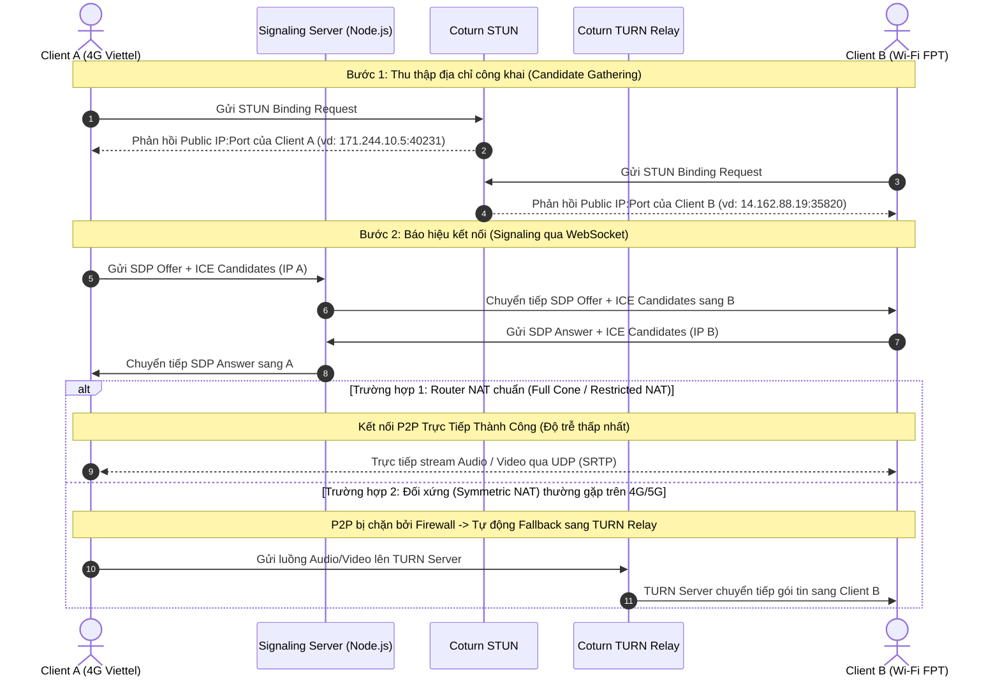

# 🏗️ Sơ Đồ Kiến Trúc Hệ Thống & Kế Hoạch Triển Khai: Chat App (Zalo-like + Real-Time AI)

Tài liệu thiết kế kiến trúc kỹ thuật toàn diện cho dự án **Chat App** — nền tảng trò chuyện thời gian thực xuyên mạng (Cross-Network), gọi thoại/video P2P và tích hợp trợ lý AI thông minh dạng streaming.

---

## 1. 🚀 Đề Xuất Tech Stack (Công Nghệ Trọng Tâm)

| Tầng Kiến Trúc | Công Nghệ Lựa Chọn | Lý Do Lựa Chọn |
| :--- | :--- | :--- |
| **Frontend Web** | React 18 / Next.js hoặc Vite + TypeScript + Tailwind CSS | Hiệu năng render tối ưu, quản lý state linh hoạt với Zustand/Redux Toolkit, UI components hiện đại. |
| **Backend API** | Node.js (NestJS hoặc Express / Fastify) | Non-blocking I/O mạnh mẽ cho các tác vụ real-time, kiến trúc module hóa sạch, dễ scale. |
| **Giao Thức Real-Time** | Socket.io hoặc `ws` (Native WebSockets) + Redis Pub/Sub | Quản lý kết nối socket theo phòng (Rooms), hỗ trợ horizontal scaling khi có nhiều node server. |
| **Gọi Audio / Video** | WebRTC (Mesh 1-1 / SFU Mediasoup cho nhóm) + Coturn | Truyền tải âm thanh/hình ảnh P2P trực tiếp với độ trễ siêu thấp (< 100ms). |
| **Cơ Sở Dữ Liệu Chính** | PostgreSQL (với Prisma ORM) hoặc MongoDB | Hỗ trợ lưu trữ quan hệ chặt chẽ (Users, Friends, Group Members) và tốc độ truy vấn index cao. |
| **Database Caching & Session**| Redis | Quản lý Socket ID mapping, cache danh sách Online, rate limiting và pub/sub messaging. |
| **Lưu Trữ Tệp (Media/File)** | Cloudflare R2 / AWS S3 + Presigned URLs | Tối ưu chi phí lưu trữ ảnh, file tài liệu, không tiêu tốn băng thông trực tiếp của backend server. |
| **AI Assistant Engine** | OpenAI API (GPT-4o mini) / Gemini 1.5 Flash (SSE Streaming)| Chi phí tối ưu, độ trễ phản hồi token đầu tiên < 400ms, hỗ trợ tiếng Việt xuất sắc. |

---

## 2. 🏛️ Sơ Đồ Luồng Kiến Trúc Tổng Thể (System Architecture Diagram)

```mermaid
flowchart TD
    subgraph Clients["Tầng Thiết Bị Khách (Clients)"]
        ClientA["Client A (4G Viettel)"]
        ClientB["Client B (Wi-Fi FPT / Home Router)"]
    end

    subgraph Gateway["Tầng Mạng & Cân Bằng Tải"]
        Nginx["Reverse Proxy (Nginx / Cloudflare)"]
    end

    subgraph AppCluster["Tầng Xử Lý Ứng Dụng (Node.js Cluster)"]
        API["REST / GraphQL API Server"]
        SocketServer1["WebSocket Server Node 1"]
        SocketServer2["WebSocket Server Node 2"]
    end

    subgraph RealTimeInfra["Tầng Trao Đổi Realtime & Cache"]
        RedisBus[("Redis Pub/Sub & Online Status Store")]
    end

    subgraph DataTier["Tầng Lưu Trữ (Persistence)"]
        MainDB[("PostgreSQL / MongoDB\n(Users, Messages, Friends)")]
        S3Storage[("Object Storage S3 / R2\n(Images, Voice Notes, Files)")]
    end

    subgraph WebRTCInfra["Hạ Tầng NAT Traversal (WebRTC Calls)"]
        CoturnServer["Coturn Server (STUN / TURN Relay)"]
    end

    subgraph AIService["Dịch Vụ Trí Tuệ Nhân Tạo (AI LLM)"]
        GeminiAPI["Google Gemini 1.5 / OpenAI API (Server-Sent Events)"]
    end

    %% Client traffic
    ClientA -->|HTTPS API Requests| Nginx
    ClientB -->|HTTPS API Requests| Nginx
    ClientA <-->|WSS Realtime Socket| Nginx
    ClientB <-->|WSS Realtime Socket| Nginx

    Nginx --> API
    Nginx --> SocketServer1
    Nginx --> SocketServer2

    SocketServer1 <--> RedisBus
    SocketServer2 <--> RedisBus
    API --> MainDB
    SocketServer1 --> MainDB
    SocketServer2 --> MainDB

    %% File uploads
    ClientA -.->|Direct Upload via Presigned URL| S3Storage

    %% WebRTC Signaling & Media
    ClientA <-->|1. Trao đổi SDP Offer/Answer qua Socket| SocketServer1
    ClientB <-->|1. Trao đổi SDP Offer/Answer qua Socket| SocketServer2
    ClientA <-->|2. STUN Check: Tìm Public IP/Port| CoturnServer
    ClientB <-->|2. STUN Check: Tìm Public IP/Port| CoturnServer
    ClientA ===|3. Direct P2P Media Stream (SRTP)| ClientB
    ClientA -.->|3b. Fallback TURN Relay nếu Symmetric NAT| CoturnServer
    CoturnServer -.->|Relay Media| ClientB

    %% AI Integration
    SocketServer1 <-->|Streaming Token (SSE)| GeminiAPI
```

---

## 3. 🗄️ Thiết Kế Cơ Sở Dữ Liệu (Database Schema)

Dưới đây là thiết kế chi tiết chuẩn hóa theo quan hệ (PostgreSQL) và tương đương Document (MongoDB):

### 3.1. Bảng `Users`
Lưu trữ thông tin định danh người dùng. Tìm kiếm bạn bè chủ yếu qua `phone_number`.

```sql
CREATE TABLE users (
    id UUID PRIMARY KEY DEFAULT gen_random_uuid(),
    phone_number VARCHAR(15) UNIQUE NOT NULL, -- Định danh chính phong cách Zalo
    display_name VARCHAR(100) NOT NULL,
    avatar_url TEXT,
    bio VARCHAR(255),
    password_hash VARCHAR(255) NOT NULL,
    is_stranger_chat_blocked BOOLEAN DEFAULT false, -- Chặn tin nhắn từ người lạ
    is_phone_hidden BOOLEAN DEFAULT false,          -- Ẩn số điện thoại khi tìm kiếm
    last_active_at TIMESTAMP WITH TIME ZONE DEFAULT NOW(),
    created_at TIMESTAMP WITH TIME ZONE DEFAULT NOW()
);

CREATE INDEX idx_users_phone ON users(phone_number);
```

### 3.2. Bảng `Friendships`
Quản lý trạng thái bạn bè và lời mời kết bạn giữa 2 bên.

```sql
CREATE TYPE friendship_status AS ENUM ('PENDING', 'ACCEPTED', 'REJECTED');

CREATE TABLE friendships (
    id UUID PRIMARY KEY DEFAULT gen_random_uuid(),
    requester_id UUID REFERENCES users(id) ON DELETE CASCADE,
    addressee_id UUID REFERENCES users(id) ON DELETE CASCADE,
    status friendship_status DEFAULT 'PENDING',
    created_at TIMESTAMP WITH TIME ZONE DEFAULT NOW(),
    updated_at TIMESTAMP WITH TIME ZONE DEFAULT NOW(),
    UNIQUE(requester_id, addressee_id)
);

CREATE INDEX idx_friendships_users ON friendships(requester_id, addressee_id, status);
```

### 3.3. Bảng `BlockedUsers`
Chặn người lạ hoặc người dùng cụ thể khỏi việc gửi tin nhắn/gọi điện.

```sql
CREATE TABLE blocked_users (
    id UUID PRIMARY KEY DEFAULT gen_random_uuid(),
    blocker_id UUID REFERENCES users(id) ON DELETE CASCADE,
    blocked_id UUID REFERENCES users(id) ON DELETE CASCADE,
    reason VARCHAR(255),
    created_at TIMESTAMP WITH TIME ZONE DEFAULT NOW(),
    UNIQUE(blocker_id, blocked_id)
);

CREATE INDEX idx_blocked_pairs ON blocked_users(blocker_id, blocked_id);
```

### 3.4. Bảng `Conversations` & `ConversationMembers`
Hỗ trợ cả cuộc trò chuyện 1-1 (Direct) và Nhóm chat (Group).

```sql
CREATE TYPE conversation_type AS ENUM ('DIRECT', 'GROUP');

CREATE TABLE conversations (
    id UUID PRIMARY KEY DEFAULT gen_random_uuid(),
    type conversation_type DEFAULT 'DIRECT',
    title VARCHAR(120), -- Áp dụng cho nhóm
    avatar_url TEXT,
    created_by UUID REFERENCES users(id),
    created_at TIMESTAMP WITH TIME ZONE DEFAULT NOW(),
    updated_at TIMESTAMP WITH TIME ZONE DEFAULT NOW()
);

CREATE TABLE conversation_members (
    conversation_id UUID REFERENCES conversations(id) ON DELETE CASCADE,
    user_id UUID REFERENCES users(id) ON DELETE CASCADE,
    role VARCHAR(20) DEFAULT 'MEMBER', -- 'ADMIN', 'MEMBER'
    joined_at TIMESTAMP WITH TIME ZONE DEFAULT NOW(),
    PRIMARY KEY (conversation_id, user_id)
);
```

### 3.5. Bảng `Messages`
Lưu trữ nội dung tin nhắn, đính kèm tệp và mốc thời gian UTC.

```sql
CREATE TYPE message_type AS ENUM ('TEXT', 'IMAGE', 'FILE', 'AUDIO', 'VIDEO_CALL_LOG', 'AI_SUMMARY');
CREATE TYPE message_status AS ENUM ('SENT', 'DELIVERED', 'READ');

CREATE TABLE messages (
    id UUID PRIMARY KEY DEFAULT gen_random_uuid(),
    conversation_id UUID REFERENCES conversations(id) ON DELETE CASCADE,
    sender_id UUID REFERENCES users(id) ON DELETE SET NULL, -- Null nếu do hệ thống/AI tạo
    type message_type DEFAULT 'TEXT',
    content TEXT,                                          -- Nội dung tin nhắn hoặc prompt
    attachment_url TEXT,                                   -- Đường dẫn file trên S3
    file_meta JSONB,                                       -- { "name": "doc.pdf", "size": 2400000, "mime": "application/pdf" }
    status message_status DEFAULT 'SENT',
    created_at TIMESTAMP WITH TIME ZONE DEFAULT NOW()      -- Luôn lưu dạng UTC
);

CREATE INDEX idx_messages_conversation_time ON messages(conversation_id, created_at DESC);
```

---

## 4. ⚡ Bảng Ánh Xạ Sự Kiện WebSocket (Event Mapping)

Hệ thống sử dụng các cặp sự kiện (Event Name) rõ ràng để truyền tải trạng thái thời gian thực:

| Kênh / Nhóm | Tên Sự Kiện (Client -> Server) | Tên Sự Kiện (Server -> Client) | Mô Tả Dữ Liệu & Hành Vi |
| :--- | :--- | :--- | :--- |
| **Xác Thực Kết Nối** | `connection` (gửi kèm JWT) | `auth:authenticated` / `auth:error` | Xác minh token người dùng, lưu `socket.id` vào Redis gắn với `user_id`. |
| **Trạng Thái Hoạt Động**| Tự động heartbeat ping | `user:online_status` | Báo đối phương người này vừa Online hoặc Offline (`last_active_at`). |
| **Gửi Nhận Tin Nhắn** | `message:send` | `message:received` | Client gửi payload `{ conversationId, content, type, tempId }`. Server broadcast tới room conversation. |
| **Biên Nhận Tin Nhắn** | `message:mark_read` | `message:status_updated` | Đổi trạng thái từ `SENT` -> `DELIVERED` -> `READ` kèm mốc thời gian. |
| **Đang Soạn Thảo** | `typing:start`, `typing:stop` | `typing:update` | Hiển thị bong bóng chấm chuyển động khi đối phương đang gõ văn bản. |
| **Trợ Lý AI Streaming**| `ai:query_stream` | `ai:token_chunk`, `ai:stream_end` | Server gọi LLM (Gemini/OpenAI) và stream từng đoạn token về trực tiếp socket người hỏi. |
| **Báo Hiệu WebRTC (Call)**| `call:initiate` | `call:incoming` | Người gọi bắt đầu phiên: truyền `{ calleeId, callType: 'audio' \| 'video' }`. |
| **Trao Đổi Tín Hiệu Call**| `call:signal_offer`, `call:signal_answer` | `call:signal_received` | Trao đổi Session Description Protocol (SDP) giữa 2 trình duyệt. |
| **Trao Đổi Ứng Viên Mạng**| `call:ice_candidate` | `call:ice_candidate_received` | Trao đổi các địa chỉ IP/Port thu thập từ STUN để thiết lập kênh P2P. |
| **Kết Thúc Cuộc Gọi** | `call:end` | `call:terminated` | Đóng kết nối P2P, ghi log thời lượng cuộc gọi vào bảng Messages. |

---

## 5. 🌐 Chiến Lược Kết Nối Đa Mạng & Vượt Tường Lửa (NAT Traversal Strategy)

### Vấn Đề Kỹ Thuật
Khi 2 người dùng ở 2 mạng khác nhau (ví dụ: một người dùng Wi-Fi gia đình qua router NAT, một người dùng 4G di động của nhà mạng), thiết bị của họ chỉ có **Private IP** (như `192.168.1.5` hoặc `10.x.x.x`). Hai thiết bị không thể ping hoặc gửi gói tin UDP trực tiếp cho nhau.

### Giải Pháp: ICE, STUN và TURN Server



#### Cấu hình mẫu WebRTC `RTCConfiguration` trên Client:
```javascript
const peerConnection = new RTCPeerConnection({
  iceServers: [
    // STUN miễn phí công cộng để dò Public IP
    { urls: 'stun:stun.l.google.com:19302' },
    { urls: 'stun:stun1.l.google.com:19302' },
    
    // TURN Server riêng (Coturn triển khai trên VPS Linux) để dự phòng chuyển tiếp
    {
      urls: 'turn:turn.chatapp.yourdomain.com:3478',
      username: 'user_session_token',
      credential: 'generated_secure_password'
    }
  ],
  iceCandidatePoolSize: 10
});
```

---

## 6. 🤖 Kiến Trúc Tích Hợp AI Streaming Trong Luồng Chat

Để đảm bảo phản hồi tức thì và không làm nghẽn Event Loop của Node.js:
1. **Triggering**: Người dùng chat riêng với bot AI hoặc gõ lệnh `@ai [câu hỏi]` trong nhóm.
2. **Context Aggregator**: Backend truy vấn 5 tin nhắn gần nhất trong đoạn chat làm context.
3. **Streaming Call**: Backend gọi đến Gemini 1.5 Flash / OpenAI với cờ `stream: true`.
4. **Socket Chunking**: Ngay khi nhận được `chunk` token từ LLM qua giao thức Server-Sent Events (SSE), Socket server emit ngay sự kiện `ai:token_chunk` tới đúng room của người dùng.
5. **Persistence**: Khi quá trình stream hoàn tất (`stream_end`), backend gom toàn bộ nội dung hoàn chỉnh lại và lưu một bản ghi duy nhất vào bảng `messages` với `type = 'AI_SUMMARY'`.
